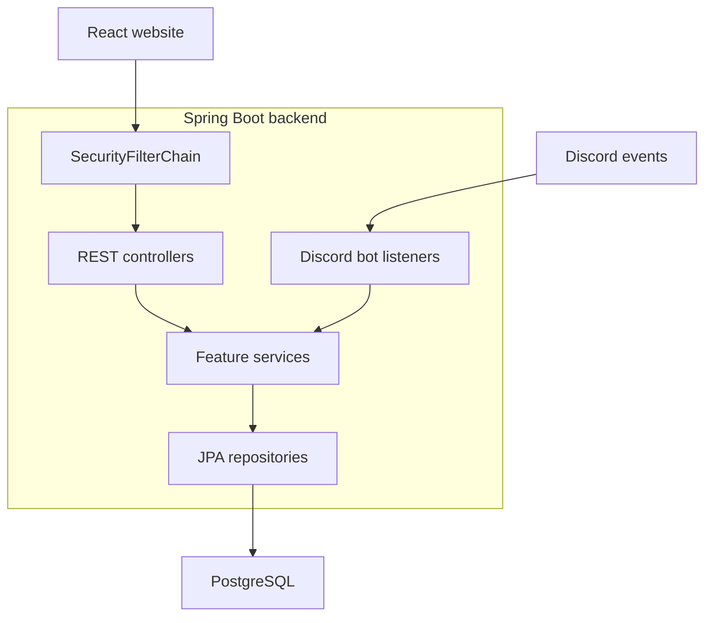

# Architecture

> Initial architecture baseline for Study Together.
> Update when architecture or major flows change.
> Unresolved decisions are marked as TBD.

> Planning update, 2026-10-22: this baseline describes the Discord core. The final section records provisional extension choices from [API_SPEC.md](./API_SPEC.md); none implies implemented code.

---

## High-Level Architecture

- The React website displays profiles, study history, statistics, and leaderboards.
- The Discord bot runs inside the Java backend under `discord/`.
- Controllers and bot listeners delegate business logic to services.
- Business services use [Feature]Service interfaces in service/ and [Feature]ServiceImpl implementations in service/impl/, including when only one implementation exists. Consumers inject interfaces; repositories handle database access (user-confirmed convention, 2026-10-31; see PROJECT-RULES.md section 3).

---

## Request and Event Flows

### Standard API Request

1. The website sends an HTTP request.
2. Spring Security validates the application JWT for protected endpoints.
3. The controller validates request DTOs with `@Valid`.
4. The service executes business logic through repositories.
5. The service maps entities to response DTOs.
6. The controller returns `ApiResponse<T>` with the appropriate HTTP status.

API routes use the `/api/v1/...` prefix.

### Authentication Flow

1. The website starts Discord OAuth2 login through the backend.
2. Discord authenticates the user and redirects to the backend callback.
3. Spring Security's OAuth2 Client completes the authorization code flow.
4. The backend resolves the internal user linked to the verified Discord ID.
5. The backend issues its own access JWT for website API requests.
6. Subsequent requests send `Authorization: Bearer <access_token>`.
7. OAuth2 Resource Server validates the JWT and establishes the authenticated user.

Rules:
- JWT `sub` contains the internal user ID.
- Discord OAuth2 tokens and application JWTs serve different purposes.
- Login must reuse existing Discord-linked identity and study history.
- Confirmed flow, 2026-10-30 (Planned): someone already tracked through Discord signs into the website with that same Discord account and can study on WEB or DISCORD without a separate link step. Someone using another website login method with no Discord identity uses explicit Discord linking to the current user. Switching study sources does not require relinking; conflicts between distinct existing users remain a separate unresolved merge workflow.
- Additional login providers may be added without replacing internal user IDs.
- OAuth2 login may use a temporary session to track the login flow; protected APIs authenticate using JWTs.
- Frontend token delivery/storage and refresh-token behavior: **TBD**.

### Discord Study Tracking Flow

Implementation checkpoint, 2026-11-02: DiscordVoiceListener injects StudySessionService and maps JDA voice updates into DiscordVoiceUpdateCommand, and video/stream updates into DiscordMediaUpdateCommand. All callbacks exclude bots; media callbacks outside voice are ignored. Commands carry trusted IDs, both media flags, and backend observation time. Services use native SQL lookups and ordinary Transactional boundaries to resolve identity, create initial segments, close/replace intervals atomically, and retain an existing user session when another start is requested. See PROJECT-STATUS.md for isolated listener/persistence checks. Live Discord verification, conflict delivery, concurrency/replay handling, and recovery remain pending; website reads below remain a target.

1. Discord sends study-room and camera/screen-sharing events.
2. Bot listeners identify the participant and affected room.
3. Feature services update study tracking and persist the relevant data.
4. The website reads stored history, statistics, and rankings through APIs.

Rules:
- Recording does not require the participant to have logged into the website.
- Track total study time and time with camera or screen sharing active.
- Leaving a study room stops time tracking for that room.
- Duplicate events must not double-count study time.
- Equal study durations receive the same leaderboard rank.
- Recovery after downtime, reconnects, restarts, or missed events: **TBD**.

### Authorization Flow

- Explicitly configured public endpoints allow unauthenticated access.
- Other endpoints require a valid application JWT.
- Apply ownership or role checks where the operation requires them.
- Detailed public, member, and administrator permissions: **TBD**.

---

## Layer-Based Package Structure

The user requested central packages by layer on 2026-10-31. Create each package only when it contains implementation.

Entities now live under entity, Spring Data repositories under repository, service interfaces under service, and interface implementations under service/impl. UserIdentityService/UserIdentityServiceImpl retain identity resolution, and StudySessionServiceImpl implements StudySessionService to orchestrate session/segment persistence. Discord listeners now call the service interface through records in dto/study; controllers remain planned. Enum values and SQL mappings are unchanged. The former feature layout is superseded; its decision history remains in PROJECT-RULES.md and the business contexts.

| Package | Responsibility |
|---|---|
| `entity/` | User, identity, room, session, and segment ORM mappings |
| `repository/` | Database access through Spring Data JPA |
| `service/`, `service/impl/` | Business contracts and their implementations |
| `enums/` | UserStatus, IdentityProvider, and StudySource |
| `discord/config/`, `discord/listener/` | Bot lifecycle and Discord event entry points |
| `persistence/` | Shared ORM types such as BaseEntity |
| `dto/study/` | Internal Discord voice/media command records |
| `controller/` (Planned) | REST endpoints; API request/response records will also use dto by domain |

Future shared infrastructure may live in config, security, exception, and util when needed. Business documentation lives in [user context](./contexts/user/CONTEXT.md) and [study context](./contexts/study/CONTEXT.md).

### Business Dependencies

- `auth` uses `user` services to resolve login identities.
- `discord` delegates to `user` and `study` services as needed.
- `leaderboard` reads recorded study data to calculate rankings.
- Cross-domain business operations use service contracts. Consumers of UserIdentityService inject its interface rather than UserIdentityServiceImpl; avoid circular dependencies.
- Database queries remain in repositories.
- No circular dependencies are allowed.

---

## Cross-Cutting Concerns

### Security

- Use Spring Security's OAuth2 Client for Discord login.
- Validate application JWTs through OAuth2 Resource Server.
- Use `JwtEncoder` for token issuance and `JwtDecoder` for validation.
- JWT algorithm: HS512.
- Access-token lifetime: 15 minutes by default, configurable.
- Load JWT secrets and Discord credentials from environment variables.
- Configure CORS and CSRF according to the website origin and token/cookie handling.
- Refresh-token strategy and lifetime: **TBD**, documented in `docs/decisions/`.

### Exception Handling

- `GlobalExceptionHandler` handles REST controller exceptions.
- Security handlers return consistent JSON errors for authentication and authorization failures.
- JSON API responses use `ApiResponse<T>`; redirects and no-content responses are exceptions.
- The HTTP status and `ApiResponse.statusCode` must match.
- Log bot/background failures at their handling boundary.
- Never expose stack traces, SQL errors, or credentials to clients.

### Time and Audit Fields

- Use `Instant` for event timestamps and applicable audit fields.
- Serialize timestamps in UTC.
- Display times and calculate daily/weekly reporting boundaries using `Asia/Ho_Chi_Minh`.
- Calculate study durations from actual timestamps.
- Define entity audit fields according to `docs/DATABASE.md`.
- Support for other user timezones is outside the initial scope.

### DTO Strategy

- Request and response DTOs are Java Records.
- Validate request DTOs using Jakarta Bean Validation.
- Do not expose JPA entities through APIs.
- Perform entity-to-DTO mapping in services.
- Response DTOs may provide a static `fromEntity()` factory.
- DTOs live under dto, with domain subpackages such as dto/user or dto/study when needed.

### Transactions

- Use service-level transactions for related database changes.
- Demo identity resolution uses ordinary Transactional to find an existing identity or create its user/identity atomically. Automatic concurrent-creation recovery and independent transactions are deferred in [DEFERRED-IMPROVEMENTS.md](./DEFERRED-IMPROVEMENTS.md).
- Keep Discord and other external network calls outside database transactions.
- Define concurrency handling where simultaneous events could affect study-time accuracy.

### Schema Ownership

- Current draft SQL in docs/sql/schema.sql defines tables, types, defaults, constraints, and indexes. Flyway is disabled, Hibernate uses ddl-auto:none, and automatic SQL initialization is off while the main SQL is unfinished.
- Entity annotations retain ORM mapping/runtime behavior without duplicating DDL. Do not create or enable V1 until the user explicitly finalizes the main SQL; SQL ownership is independent of that later migration checkpoint.
- After finalization, introduce versioned SQL migrations, enable Flyway, and switch Hibernate to validate. Applied migrations then stay unchanged; existing databases need explicit adoption under ADR-003.
- CHECK constraints remain deferred. SqlSchemaTest can apply the draft to fresh isolated PostgreSQL and explicitly validate mappings/round trips without starting Spring or Discord. A passing draft test does not approve the baseline.

---

## Scalability Notes

### Initial Design

- One Spring Boot backend instance with the Discord bot enabled.
- One PostgreSQL database.
- JWT authentication for protected website APIs.
- Bot processing and OAuth2 login may maintain state; JWT alone does not make the entire application stateless.

### Future Considerations

- Before adding backend instances, define bot ownership and shared-state handling to prevent duplicate processing.
- Add caching or background aggregation if measured load requires it.
- Consider separating the bot runtime if deployment or scaling needs justify it.

These are future options, not initial implementation requirements.

## API Draft Extensions — 2026-10-22

On 2026-10-30 the user confirmed multiple website login methods, timed study on the website without requiring Discord, and linking Discord to an account created through another method as Planned requirements. Login provider and study source are independent; linked WEB/DISCORD history belongs to the same internal user. Google/local login remain candidate drafts, and detailed contracts/defaults below remain provisional and unimplemented. Extend the layer-based structure above when implementing these capabilities; do not create a package per endpoint.

- `auth` owns login providers and application login/token lifecycles; `user` owns the internal profile and verified external identity links. Local credentials require a separate persistence design. Additional providers are extension work beyond the initial Discord baseline in PROJECT-RULES.md.
- `study` coordinates WEB and DISCORD sessions, browser presence, expiry, and source conflicts. Confirmed 2026-10-31 (Planned): one active session per internal user across identities/sources; the existing session retains priority and a second start is blocked. This prevents a second credited session rather than blocking login/Discord voice entry. User-level transaction/constraint coordination remains implementation work; notification delivery and source handoff details remain draft.
- Browser study uses 30-second heartbeats and a 120-second lease; expiry closes at the last confirmed observation. Initial web visual credit is zero. A new confirmed Discord observation may start tracking after WEB ends, without backfill.
- Dashboard defaults to lifetime completed, non-review history; the active timer is separate. Leaderboards use the same eligibility/time rules and competition ranking. Compute from retained history initially.
- Linking an identity owned by another internal user returns conflict. Account merging, overlap reconciliation, and unlinking need their own workflow; names/emails are not automatic linking keys.
- Draft room disable behavior closes active Discord sessions; add/re-enable reconciles fresh presence. All transitions coordinate with concurrent study events.
- The browser authentication draft uses access JWTs, opaque rotating refresh cookies, CSRF protection, and persisted login lifecycle checks for immediate current-login logout. OAuth login can use temporary state separately. [ADR-001](./decisions/001-refresh-token-strategy.md) now records this proposed lifecycle and replaces the template's dual-source design. Shared lifecycle locking coordinates refresh, replay revocation, and logout; the behavior remains unimplemented.

Contracts and working defaults are in API_SPEC.md; required schema additions are in section 11 of DATABASE.md. Revise these notes when implementing the corresponding feature. Remaining baseline TBD items require integration/design checks; the API's provisional defaults do not establish validation or completion.
