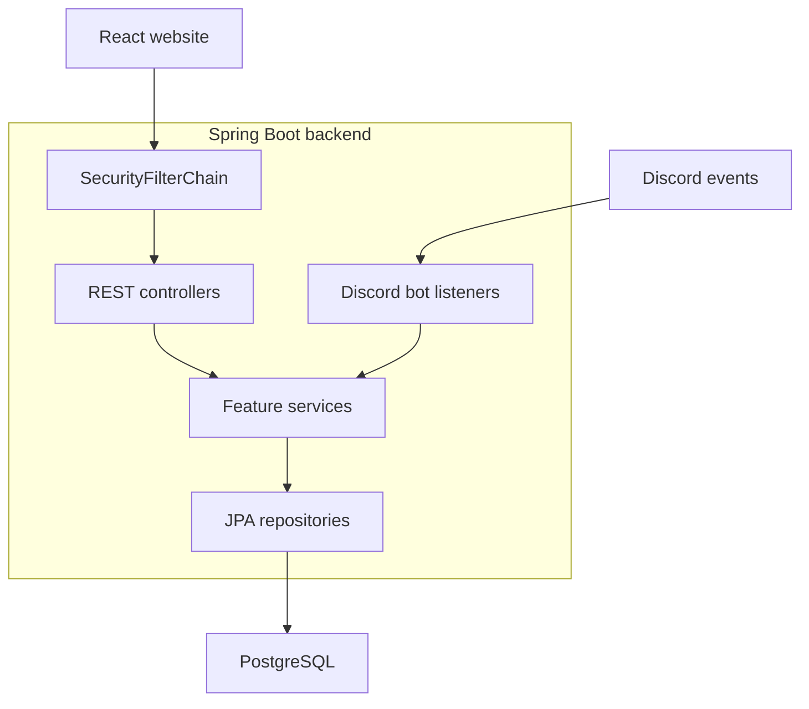

# Architecture

> Initial architecture baseline for Study Together.
> Update when architecture or major flows change.
> Unresolved decisions are marked as TBD.

> Planning update, 2026-10-22: this baseline describes the Discord core. The final section records provisional extension choices from [API_SPEC.md](./API_SPEC.md); none implies implemented code.

---

## High-Level Architecture

- The React website displays profiles, study history, statistics, and leaderboards.
- The Discord bot runs inside the Java backend under `feature/discord/`.
- Controllers and bot listeners delegate business logic to services.
- Services use interfaces and implementations; repositories handle database access.

---

## Request and Event Flows

### Standard API Request

1. The website sends an HTTP request.
2. Spring Security validates the application JWT for protected endpoints.
3. The controller validates request DTOs with `@Valid`.
4. The service executes business logic through repositories.
5. The service maps entities to response DTOs.
6. The controller returns `ApiResponse<T>` with the appropriate HTTP status.

API routes use the `/api/v1/...` prefix.

### Authentication Flow

1. The website starts Discord OAuth2 login through the backend.
2. Discord authenticates the user and redirects to the backend callback.
3. Spring Security's OAuth2 Client completes the authorization code flow.
4. The backend resolves the internal user linked to the verified Discord ID.
5. The backend issues its own access JWT for website API requests.
6. Subsequent requests send `Authorization: Bearer <access_token>`.
7. OAuth2 Resource Server validates the JWT and establishes the authenticated user.

Rules:
- JWT `sub` contains the internal user ID.
- Discord OAuth2 tokens and application JWTs serve different purposes.
- Login must reuse existing Discord-linked identity and study history.
- Additional login providers may be added without replacing internal user IDs.
- OAuth2 login may use a temporary session to track the login flow; protected APIs authenticate using JWTs.
- Frontend token delivery/storage and refresh-token behavior: **TBD**.

### Discord Study Tracking Flow

1. Discord sends study-room and camera/screen-sharing events.
2. Bot listeners identify the participant and affected room.
3. Feature services update study tracking and persist the relevant data.
4. The website reads stored history, statistics, and rankings through APIs.

Rules:
- Recording does not require the participant to have logged into the website.
- Track total study time and time with camera or screen sharing active.
- Leaving a study room stops time tracking for that room.
- Duplicate events must not double-count study time.
- Equal study durations receive the same leaderboard rank.
- Recovery after downtime, reconnects, restarts, or missed events: **TBD**.

### Authorization Flow

- Explicitly configured public endpoints allow unauthenticated access.
- Other endpoints require a valid application JWT.
- Apply ownership or role checks where the operation requires them.
- Detailed public, member, and administrator permissions: **TBD**.

---

## Feature Package Structure

Each business feature contains only the components it needs.

| Package | Responsibility |
|---|---|
| `feature/auth/` | OAuth2 login and application token management |
| `feature/user/` | Internal user identity, Discord linking, and profiles |
| `feature/discord/` | Bot lifecycle, listeners, and Discord interactions |
| `feature/study/` | Study-room configuration, study sessions, duration calculation, history, and statistics |
| `feature/leaderboard/` | Study rankings and tied scores |

Shared components live in `config/`, `security/`, `exception/`, `dto/`, and `util/`.

### Feature Dependencies

- `auth` uses `user` services to resolve login identities.
- `discord` delegates to `user` and `study` services as needed.
- `leaderboard` reads recorded study data to calculate rankings.
- Cross-feature business operations use service interfaces.
- Database queries remain in repositories.
- No circular dependencies are allowed.

---

## Cross-Cutting Concerns

### Security

- Use Spring Security's OAuth2 Client for Discord login.
- Validate application JWTs through OAuth2 Resource Server.
- Use `JwtEncoder` for token issuance and `JwtDecoder` for validation.
- JWT algorithm: HS512.
- Access-token lifetime: 15 minutes by default, configurable.
- Load JWT secrets and Discord credentials from environment variables.
- Configure CORS and CSRF according to the website origin and token/cookie handling.
- Refresh-token strategy and lifetime: **TBD**, documented in `docs/decisions/`.

### Exception Handling

- `GlobalExceptionHandler` handles REST controller exceptions.
- Security handlers return consistent JSON errors for authentication and authorization failures.
- JSON API responses use `ApiResponse<T>`; redirects and no-content responses are exceptions.
- The HTTP status and `ApiResponse.statusCode` must match.
- Log bot/background failures at their handling boundary.
- Never expose stack traces, SQL errors, or credentials to clients.

### Time and Audit Fields

- Use `Instant` for event timestamps and applicable audit fields.
- Serialize timestamps in UTC.
- Display times and calculate daily/weekly reporting boundaries using `Asia/Ho_Chi_Minh`.
- Calculate study durations from actual timestamps.
- Define entity audit fields according to `docs/DATABASE.md`.
- Support for other user timezones is outside the initial scope.

### DTO Strategy

- Request and response DTOs are Java Records.
- Validate request DTOs using Jakarta Bean Validation.
- Do not expose JPA entities through APIs.
- Perform entity-to-DTO mapping in services.
- Response DTOs may provide a static `fromEntity()` factory.
- Feature-specific DTOs live in the feature's `dto/` package.

### Transactions

- Use service-level transactions for related database changes.
- Keep Discord and other external network calls outside database transactions.
- Define concurrency handling where simultaneous events could affect study-time accuracy.

---

## Scalability Notes

### Initial Design

- One Spring Boot backend instance with the Discord bot enabled.
- One PostgreSQL database.
- JWT authentication for protected website APIs.
- Bot processing and OAuth2 login may maintain state; JWT alone does not make the entire application stateless.

### Future Considerations

- Before adding backend instances, define bot ownership and shared-state handling to prevent duplicate processing.
- Add caching or background aggregation if measured load requires it.
- Consider separating the bot runtime if deployment or scaling needs justify it.

These are future options, not initial implementation requirements.

## API Draft Extensions — 2026-10-22

The revisable API template adds planned Google/local login, verified account linking, and web study without changing the internal user as the owner of history. Keep the feature package structure above; these capabilities extend existing feature responsibilities rather than requiring a package per endpoint.

- `auth` owns login providers and application login/token lifecycles; `user` owns the internal profile and verified external identity links. Local credentials require a separate persistence design. Additional providers are extension work beyond the initial Discord baseline in PROJECT-RULES.md.
- `study` coordinates WEB and DISCORD sessions, browser presence, expiry, and source conflicts through a common per-user transaction/locking rule. Enforce one open credited session across sources and preserve non-overlapping history. Draft default: the existing session retains priority.
- Browser study uses 30-second heartbeats and a 120-second lease; expiry closes at the last confirmed observation. Initial web visual credit is zero. A new confirmed Discord observation may start tracking after WEB ends, without backfill.
- Dashboard defaults to lifetime completed, non-review history; the active timer is separate. Leaderboards use the same eligibility/time rules and competition ranking. Compute from retained history initially.
- Linking an identity owned by another internal user returns conflict. Account merging, overlap reconciliation, and unlinking need their own workflow; names/emails are not automatic linking keys.
- Draft room disable behavior closes active Discord sessions; add/re-enable reconciles fresh presence. All transitions coordinate with concurrent study events.
- The browser authentication draft uses access JWTs, opaque rotating refresh cookies, CSRF protection, and persisted login lifecycle checks for immediate current-login logout. OAuth login can use temporary state separately. [ADR-001](./decisions/001-refresh-token-strategy.md) now records this proposed lifecycle and replaces the template's dual-source design. Shared lifecycle locking coordinates refresh, replay revocation, and logout; the behavior remains unimplemented.

Contracts and working defaults are in API_SPEC.md; required schema additions are in section 11 of DATABASE.md. Revise these notes when implementing the corresponding feature. Remaining baseline TBD items require integration/design checks; the API's provisional defaults do not establish validation or completion.
