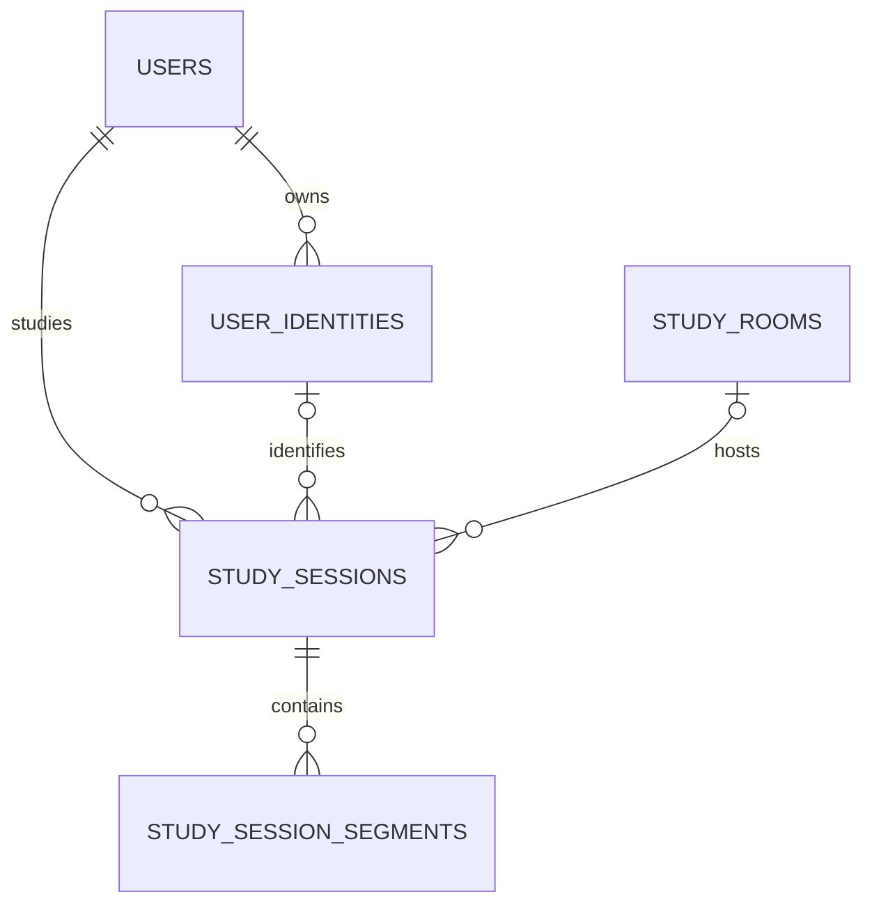

# Study Together — Database Design

Status: proposed design for the initial implementation. This document describes a target schema, not an implemented database. Business rules come from the project workbook and agreed discussion. PostgreSQL, UUID internal IDs, the five core tables, and the optional authentication tables below form the design proposal.

Planning update, 2026-10-22: sections 1–10 retain the Discord core baseline. Section 11 records extension dependencies and provisional defaults from the new [API draft](./API_SPEC.md); it does not claim the extensions or migrations exist.

## 1. Scope

Initial scope: Discord identities and login, tracked Discord rooms, study history, profile statistics, and leaderboards. The bot runs inside the Java backend. Discord OAuth2 identifies the user; the backend issues its own JWT access token.

Keep future Google login, local credentials, web study, achievements, rewards, habits, chat, and games as extensions. Their business rules are still open; do not create their tables solely from this list.

## 2. Relationships

An identity and a room are required for a Discord session. Nullable foreign keys leave room for a future authenticated study source whose rules differ. Each valid session starts with one segment; a finished session has one or more consecutive segments. The database foreign key alone cannot require the first segment to exist.

## 3. Conventions

- Use UUIDs as internal primary keys and reference `users.id` throughout business modules. Do not use a Discord ID as the user primary key.
- Store provider subjects and Discord IDs as strings. Treat names and avatar URLs as changeable profile data.
- Store instants in PostgreSQL `TIMESTAMPTZ`, map them to Java `Instant`, and use UTC for application/database session configuration. Display and reporting use `Asia/Ho_Chi_Minh`; UTC storage still supports Vietnam-only operation.
- Use half-open intervals `[start, end)`. Derive reporting boundaries in Vietnam time, then convert them to instants.
- `ended_at = NULL` means ongoing. Avoid a second session status field that can disagree with it.
- `created_at` and `updated_at` are technical audit timestamps. The application must update `updated_at`; a SQL default runs only on insertion.
- Foreign keys use `ON DELETE RESTRICT` to protect dependent history. Disable accounts and room tracking through explicit workflows. Data erasure/anonymization requires a separate policy.
- Use versioned migrations. Any schema change remains reviewable; do not use automatic schema recreation against retained data.

## 4. Core Tables

All tables have `id UUID` as the primary key plus `created_at` and `updated_at` as required `TIMESTAMPTZ` fields.

### 4.1 `users` — Internal account and profile

| Column | Type | Meaning |
|---|---|---|
| `display_name` | `VARCHAR(255)`, nullable | Website display name; missing profile data is allowed. |
| `avatar_url` | `TEXT`, nullable | Website profile image URL. |
| `status` | `VARCHAR(20)` | `ACTIVE` or `DISABLED`; initial permission policy is separate. |
| `first_web_login_at` | `TIMESTAMPTZ`, nullable | First successful website login; null allows bot-created users. |

No required email or password. A Discord member can accumulate study history before visiting the website. The same internal account must be reused at first Discord login. Total study time and rank are derived data, not mutable profile columns.

### 4.2 `user_identities` — Linked external identity

| Column | Type | Meaning |
|---|---|---|
| `user_id` | `UUID`, FK | Owning internal user. |
| `provider` | `VARCHAR(32)` | Canonical provider code; initially `DISCORD`. |
| `provider_subject` | `VARCHAR(255)` | Stable provider user ID; Discord user ID initially. |
| `provider_display_name` | `VARCHAR(255)`, nullable | Cached provider name. |
| `provider_avatar_url` | `TEXT`, nullable | Cached provider avatar. |
| `last_authenticated_at` | `TIMESTAMPTZ`, nullable | Last verified login through this provider; bot observation alone does not set it. |

Constraints: unique `(provider, provider_subject)`; unique `(user_id, id)` supports the session ownership foreign key. The latter also indexes identities by user.

Bot observation and OAuth login both resolve the same provider/subject pair. If two requests race to create it, roll back the losing transaction and reread the existing identity. Create the user and identity together so a failed identity insert does not leave an unused user. Never merge accounts automatically by name or email. Linking another identity requires proof of control and an agreed conflict policy.

The schema allows multiple identities per user. Whether multiple accounts from the same provider may be linked is a service policy to decide when linking is implemented.

### 4.3 `study_rooms` — Tracked Discord channel

| Column | Type | Meaning |
|---|---|---|
| `discord_guild_id` | `VARCHAR(20)` | Discord server ID. |
| `discord_channel_id` | `VARCHAR(20)` | Discord voice channel ID. |
| `display_name` | `VARCHAR(255)`, nullable | Cached channel label. |
| `tracking_enabled` | `BOOLEAN` | Whether new study sessions may start here. |

Unique `(discord_guild_id, discord_channel_id)`. Before registration, the bot validates the channel, guild, and access. Renaming a channel does not create a different room. Disabling tracking preserves history; treatment of users already present still needs a decision.

This table models Discord tracking configuration. If future website rooms need membership, invitations, or scheduling, design that concept explicitly and migrate the relationship rather than forcing it into Discord-only fields.

### 4.4 `study_sessions` — Continuous presence in one room

| Column | Type | Meaning |
|---|---|---|
| `user_id` | `UUID`, FK | Internal owner of this history. |
| `source` | `VARCHAR(32)` | Initially `DISCORD`; future sources require new service rules. |
| `identity_id` | `UUID`, nullable FK | Identity used by the source; required for Discord. |
| `study_room_id` | `UUID`, nullable FK | Tracked room; required for Discord. |
| `started_at` | `TIMESTAMPTZ` | Backend observation of entry/start. |
| `ended_at` | `TIMESTAMPTZ`, nullable | Observed end, or an explicitly chosen recovery boundary. |
| `last_observed_at` | `TIMESTAMPTZ` | Latest persisted presence observation/checkpoint. |
| `end_reason` | `VARCHAR(40)`, nullable | Proposed codes: `LEFT_ROOM`, `MOVED_ROOM`, `ROOM_DISABLED`, `RECOVERY_UNCERTAIN`; exact recovery/toggle behavior is pending. |
| `needs_review` | `BOOLEAN` | Marks uncertain history for an explicit reconciliation policy. |

Database rules:

- One open Discord session per internal user, enforced by a partial unique index.
- Discord sessions require both an identity and a tracked room.
- Composite FK `(user_id, identity_id)` prevents recording someone else's identity on a session.
- End cannot precede start; checkpoint cannot precede start or exceed a known end.
- An open session has no end reason; a finished session has one.

Service rules: identity provider must match `source`, room must be enabled at start, bot accounts are excluded, and historical Discord intervals must not overlap for a user. Optional `hardening.sql` also enforces historical non-overlap in PostgreSQL.

The session interval measures total study time even with camera and screen sharing both off. Microphone mute/deafen does not stop it. Moving from tracked room A to B closes A and starts B at the same observed instant in one transaction.

### 4.5 `study_session_segments` — Camera/share state intervals

| Column | Type | Meaning |
|---|---|---|
| `study_session_id` | `UUID`, FK | Parent study session. |
| `started_at` | `TIMESTAMPTZ` | State becomes active at this boundary. |
| `ended_at` | `TIMESTAMPTZ`, nullable | State stops; null for the current segment. |
| `camera_on` | `BOOLEAN` | Camera state during the interval. |
| `screen_share_on` | `BOOLEAN` | Screen sharing state during the interval. |

Persist both-off intervals as well. When either state changes, close the current segment and open the next at the same instant. Unchanged state needs no new segment. If several changes share the current segment's start instant, update that boundary state instead of creating duplicate or zero-length segments.

Database rules: unique `(study_session_id, started_at)`, at most one open segment per session, and end cannot precede start. Service rules: segments belong inside their parent interval, are consecutive with no gaps or overlaps, and exactly cover the observed session. Closing a session closes its segment in the same transaction. Optional range constraints enforce non-overlap but cannot prove full coverage or parent containment.

This retains enough history for total, visual, camera-only, and share-only metrics without changing old session records.

## 5. Time Calculation

For a report window `[from, to)`, clip each interval to that window. Sum exact durations first, then floor the final sum to whole seconds.

- Total: sum clipped session intervals.
- Visual: sum clipped segments where `camera_on OR screen_share_on`.
- Camera: sum clipped segments where `camera_on`.
- Screen sharing: sum clipped segments where `screen_share_on`.

Visual time is part of total time, not a bonus added to it. Do not add camera and sharing totals to obtain visual time: their overlap would be counted twice. Aggregate sessions and segments separately; joining sessions directly to all segments before summing session durations would multiply total time.

Example, one session from 09:00 to 10:00 Vietnam time:

| Segment | Camera | Sharing | Total minutes | Visual minutes |
|---|---|---|---:|---:|
| 09:00–09:10 | Off | Off | 10 | 0 |
| 09:10–09:30 | On | Off | 20 | 20 |
| 09:30–09:40 | On | On | 10 | 10 |
| 09:40–09:50 | Off | On | 10 | 10 |
| 09:50–10:00 | Off | Off | 10 | 0 |
| **Sum** | | | **60** | **40** |

Camera is 30 minutes and sharing is 20 minutes; their common 10 minutes counts once in visual time. A 23:50–00:20 session contributes 10 minutes to the first date and 20 to the next. Two 0.6-second intervals contribute one whole second after summing, not zero.

Do not persist `total_seconds`, `visual_seconds`, or rank as the initial source of truth. `example-queries.sql` demonstrates closed-session statistics and ranking. Daily aggregates or caches can be added when measured load justifies them; they must be rebuildable from retained history.

## 6. Event Processing and Recovery

- Serialize study mutations per internal user, for example by locking the `users` row in a short database transaction. Use the same locking rule for join, move, state change, leave, and reconciliation.
- Start/close sessions and their segments atomically. Validate the current room before applying leave/change events so an old-room event cannot close a new-room session.
- Deduplicate repeated events through current-state checks and the SDK's event ordering/resume information. Unique indexes alone do not solve delayed or out-of-order events.
- Capture one observation instant per state transition. Discord voice state payloads do not provide a general join/leave event timestamp; do not label backend receipt time as the exact moment of the user's action.
- Persist checkpoints while observation is healthy. After a disconnect, compare saved sessions with recovered Discord state. Do not silently credit the entire unobserved gap.
- A conservative proposed fallback is to close uncertain history at `last_observed_at`, mark `needs_review`, and start fresh at a confirmed observation. Recovery, gateway resume, and stale event policy remain to be agreed and tested with the chosen Java SDK.
- The initial model assumes one active backend/bot instance. Multiple instances need explicit event ownership and reconciliation in addition to database constraints.

## 7. Optional JWT Lifecycle Tables

JWT authentication is agreed. [ADR-001](./decisions/001-refresh-token-strategy.md) now records proposed defaults for browser refresh rotation, token lifetimes, and current-login logout; these remain subject to implementation review. The lifecycle tables below are separate from the five-table core. The referenced `auth-proposal.sql` artifact is not present in this workspace and is not an implemented migration.

| Table | Main fields | Purpose |
|---|---|---|
| `auth_sessions` | `id`, `user_id`, `created_at`, `expires_at`, `revoked_at` | One website login lifecycle, independent of study tracking. |
| `refresh_tokens` | `id`, `auth_session_id`, `token_hash`, `issued_at`, `expires_at`, `used_at`, `revoked_at` | Optional opaque refresh token rotation history; store only a digest. |

Proposed flow: JWT `sub` is the internal user UUID and `sid` identifies the login record. After signature/claim validation, check whether the login is still active if immediate logout is required. A JWT does not revoke itself before expiration just because the browser deletes it. The `auth_sessions` name describes a lifecycle record; the access token remains a JWT.

Issue high-entropy opaque refresh tokens; store a SHA-256 digest, not the raw value. Lock the login/token record, validate expiry and revocation, mark the old token used, and issue its replacement atomically. Reuse handling, concurrent refresh behavior, delivery/storage, retention, and expiration durations need agreement. Logging out must not close Discord study sessions or erase history.

Neither this proposal nor the core schema needs a table of access JWTs. Do not store Discord bot secrets or JWT signing keys in these business tables.

## 8. Extension Points

These names illustrate future modules; they are not approved schemas or migrations.

| Future idea | Likely extension | Existing data reused |
|---|---|---|
| Google login | Another `user_identities` provider, verified linking flow | Internal user and study history |
| Local email/password | `user_credentials`, verification/recovery records | `users.id` |
| Study on the website | New study source and web-specific room/presence rules | User, session/time model where rules fit |
| Roles and permissions | `roles`, `user_roles`, permissions if needed | Internal users |
| Achievements / levels | `achievements`, `user_achievements`, progress model | Observed study history |
| Items / bosses / rewards | Item catalog, inventory, reward ledger, boss contributions | Users and qualifying activity |
| Morning check-in / habits | Habit definitions, check-ins, evidence references | Users; Vietnam reporting boundaries |
| Chat | Conversations, memberships, messages | Users |
| Board games | Matches, participants, moves; guest identity rules separately | Users when a participant is registered |
| Faster statistics | Rebuildable daily aggregates or materialized views | Sessions and segments |

Adding web study requires a decision about simultaneous Discord/web activity before counting it. Separate per-source uniqueness does not prevent double credit across sources. Account merging must also reconcile identities and overlapping history; the schema does not automatically merge accounts.

Keep module data in its own tables with explicit foreign keys. Use targeted migrations when rules become clear. A new provider, metric, or feature may still require a schema change; extensibility means preserving account identity and historical meaning during those changes.

## 9. Decisions Still Needed

| Decision | Effect |
|---|---|
| Bot downtime, resume, and checkpoint frequency | Recovery boundaries, confidence flags, stale event handling |
| Disable/re-enable a room while users remain present | Whether and when current sessions end or resume |
| Include ongoing / uncertain sessions in reports | Query policy; cannot assume unobserved presence until now |
| Ranking style, zero-time users, refresh frequency | `RANK` vs `DENSE_RANK`, eligibility and refresh behavior |
| Week start and available report periods | Calendar boundaries; Vietnam timezone is agreed |
| Guest/member/admin access and disabled users | Authorization and leaderboard eligibility |
| Profile editing and provider synchronization | Which profile values override cached provider data |
| Refresh tokens, immediate logout, token lifetime and scope | Whether to apply `auth-proposal.sql` and the corresponding JWT validation logic |
| Verified identity linking and account merging | Additional workflow and uniqueness policy |

The SQL examples use closed, non-review sessions, active users with positive time, and `RANK`. These are explicit example assumptions, not finalized product decisions.

## 10. Files and Validation

- `schema.sql`: five core tables, keys, checks, and initial indexes.
- `auth-proposal.sql`: two optional authentication lifecycle tables.
- `hardening.sql`: optional PostgreSQL range exclusion constraints using `btree_gist`.
- `example-queries.sql`: parameterized statistics and leaderboard examples.
- `ERD.png` / `ERD.svg`: rendered core relationships; the image works without Mermaid support.

The time examples and SQL constraints were reviewed. PostgreSQL execution and Java SDK integration have not been verified in this environment. Run migrations and integration tests against a disposable PostgreSQL database before using them in an application.

## 11. API Draft Planning Addendum — 2026-10-22

The user requested a revisable API template. The following choices are draft implementation defaults, not completed schema changes. Existing open decisions above remain review items; where the API chooses a default, use it provisionally when designing that feature and update both documents if it changes.

### Accounts and login methods

- Keep `users` as the internal account and `user_identities` as verified external identity links. Google uses provider `GOOGLE` and verified subject; Discord remains `DISCORD`. Login provider is independent of study source.
- Draft linking permits one identity per provider per user. Add the corresponding `(user_id, provider)` uniqueness rule when that extension is implemented; the core baseline alone does not enforce it.
- Local registration needs separately designed credentials storage, including user ownership, normalized unique login email, and password hash. Do not add required passwords/emails to every user or create provider identities from unverified email matches.
- A Discord identity already owned by a different user produces a link conflict. Preserve existing users/history until a verified merge and overlap-reconciliation workflow is designed.

### Dashboard and web study

- Dashboard defaults to lifetime completed sessions with `needs_review = false`, across all supported sources. Active history is displayed separately. No mutable total-hours column is added to `users`; future aggregates must be rebuildable.
- Web study proposes `source = WEB`, with null Discord identity/room. The provider/source match rule in section 4.4 applies to Discord identity resolution; a WEB session is not assigned the provider that authenticated its owner.
- Add an optional `client_session_id UUID` to study sessions for persistent browser-attempt binding. WEB requires it; DISCORD leaves it null. Proposed unique `(user_id, client_session_id)` for WEB makes retries resolve the same attempt, including after closure. This column is not part of the five-table baseline yet.
- Before enabling WEB, replace Discord-only active uniqueness with one open credited session per internal user across WEB/DISCORD. Apply the same user-level serialization to both sources and prevent overlapping completed credited intervals. A separate index per source is insufficient.
- Existing credited source keeps priority. After WEB stops/expires, start Discord only from newly confirmed enabled-room presence, with no backfill.
- Draft heartbeat interval is 30 seconds, expiry 120 seconds; expiration closes at `last_observed_at`. Proposed additional end reasons are `USER_STOPPED` and `HEARTBEAT_TIMEOUT`. Browser presence is not proof of attention.
- Initial WEB segments have camera/share both false; web visual credit needs a later observation design.

### Other provisional behavior

- Disabling a room closes matching open Discord sessions at the configuration boundary with `ROOM_DISABLED`. Add/re-enable reconciles current presence without historical credit; serialize with joins/moves.
- Initial rankings use completed eligible total seconds, `RANK`, and active users with positive time. Daily/weekly/monthly boundaries use Vietnam time; week starts Monday.
- The API's browser-only token draft selects the optional login lifecycle/rotating-refresh concept in section 7 for future implementation: 15-minute access tokens, 3-day absolute login lifetime, current-login logout, digest-only refresh storage, cookie/CSRF handling. It is not an implemented authentication migration. Follow the proposed ADR-001 when designing atomic rotation, replay revocation, and lifecycle checks; revise the documents together if these choices change.

## References

Project requirements: [Study-Together-Theo-Doi-Du-An.xlsx](./Study-Together-Theo-Doi-Du-An.xlsx), sheets `Tổng quan`, `Chi tiết case`, and `Ý tưởng`, plus the subsequent planning discussion summarized in section 11.

Technical references: [PostgreSQL datetime types](https://www.postgresql.org/docs/current/datatype-datetime.html), [constraints](https://www.postgresql.org/docs/current/ddl-constraints.html), [partial indexes](https://www.postgresql.org/docs/current/indexes-partial.html), [range types](https://www.postgresql.org/docs/current/rangetypes.html), [Discord IDs](https://docs.discord.com/developers/reference#snowflakes), [Discord voice states](https://docs.discord.com/developers/resources/voice), and [OWASP JWT / REST security](https://cheatsheetseries.owasp.org/cheatsheets/REST_Security_Cheat_Sheet.html#jwt).
